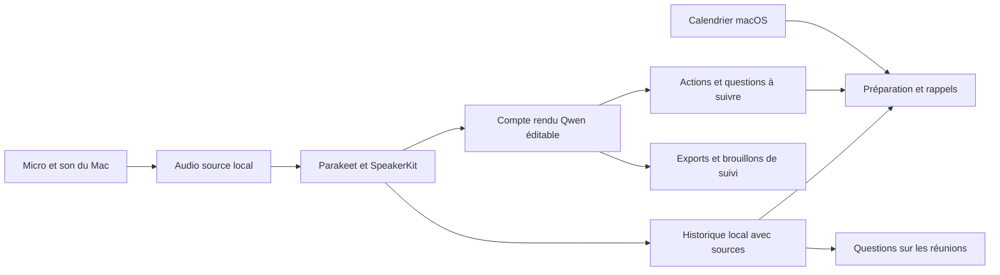

# Audit Meetings (Beta) → VoxoL

Audit du 4 octobre 2026. Référence examinée : plugin OpenAI `chatgpt-meetings` **0.8.77**, installé dans le cache Codex, et sources actuelles de `/Users/aris/Documents/Zphyr`.

**Priorité précisée par Aris : l'interface et la mise en forme de Meetings, et la façon d'interagir avec le résultat.** VoxoL possède déjà de nombreux outils ; l'audit doit d'abord montrer comment les présenter dans une page de réunion lisible, réactive et directement manipulable. Les recommandations fonctionnelles conservées plus bas constituent un complément. Les propositions de design restent à valider sur un rendu et des interactions réelles.

## Portée et niveau de preuve

- **Documentation** : documentation officielle OpenAI consultée le jour de l'audit.
- **Code** : manifests, README, trois skills, deux modèles de tâches planifiées, contrats Python et composants de l'interface compilée du plugin ; comparaison avec les chemins actifs de VoxoL.
- **Connecteur testé** : `get_profile` et `find_all` ont répondu ; `find_all(limit: 5)` a renvoyé zéro note privée, sans page suivante. Aucun `fetch` n'était donc possible.
- **Non testé** : parcours graphique complet, permissions, capture réelle, génération, partage, reprise après incident, qualité des transcriptions et performances. L'accès natif à Codex par l'outil de contrôle graphique a été refusé. Aucun contournement effectué.

« Présent dans le code » ne signifie pas validé dans l'application installée. La revue n'a ni lancé de capture ni modifié VoxoL. Les archives privées n'ont pas été ouvertes. Les fichiers déjà modifiés ou non suivis du dépôt ont été conservés.

## 0. Audit de l'interface : priorité de cette demande

Clarification utilisateur : « c'est surtout l'interface et la mise en forme qui est bien faites […] pas juste un truc statique comme nous ». Il s'agit de reprendre la qualité de présentation et les interactions, avec l'identité de VoxoL.

### Ce qui est vérifiable dans l'interface de Meetings

Le bundle 0.8.77 contient une colonne de contenu centrée et bornée, une navigation supérieure compacte et fixe, des sections de notes espacées, un volet de transcription et des états de boutons comme copie en cours/copied. La recherche apparaît à la demande, se ferme au clavier et filtre la liste. Le volet de transcription modifie la composition de la page, avec adaptations pour les petites largeurs et les langues de droite à gauche. Ces mécanismes sont inspectés dans le code compilé ; leur fluidité effective n'a pas été testée. [M10]

La qualité perçue signalée par Aris doit être étudiée comme une expérience complète : lecture, édition, consultation d'une source, action sur le résultat et retour visuel. Une animation ajoutée sur une carte ne suffit pas à créer cette continuité.

### Pourquoi VoxoL peut donner une impression statique

Ce diagnostic porte sur les sources actuelles, pas sur une mesure d'utilisabilité :

- **Plusieurs couches avant le contenu** : barre supérieure de 68 points, navigation Compte rendu/Transcription/Intervenants, en-tête détaillé du document, barre permanente de mise en forme et barre de sources. Les outils occupent une place importante avant la lecture. [V4, V7]
- **Largeur de texte liée à la fenêtre** : l'éditeur suit toute la largeur disponible, avec des marges internes de 36 points. Il n'a pas de colonne de lecture bornée comparable à celle définie dans Meetings. [V7]
- **Actions éloignées du passage** : clarification/raccourcissement dans le menu de la barre de mise en forme ; accès aux sources depuis une barre inférieure ; tâches cochables dans le volet. Les fonctions existent mais leur relation avec le contenu se découvre moins directement. [V6, V7]
- **Le document est surtout une surface de texte** : titres, paragraphes et tâches ont des styles sémantiques, mais les tâches sont rendues avec des glyphes dans le texte ; la bascule de leur état est implémentée dans le volet d'actions. [V6, V8]

VoxoL dispose déjà d'un sommaire adaptatif, de sources sélectionnées, de versions et de transitions. Le travail consiste à rendre ces interactions visibles et cohérentes dans le parcours principal.

### Direction d'interface proposée pour VoxoL

| Aspect | Adaptation proposée | Interaction attendue |
|---|---|---|
| Page de réunion | Une barre compacte, titre fort, métadonnées discrètes, contenu centré avec largeur de lecture bornée | Le document reste le point d'attention à toutes les tailles de fenêtre |
| Mise en forme | Titres liés aux sujets réellement abordés, paragraphes aérés, citations et actions clairement différenciées | Navigation par sections ; pas de gabarit obligeant chaque réunion à remplir les mêmes cartes |
| Lecture et édition | Lecture comme état initial ; édition accessible sur le document | Les outils d'édition apparaissent au focus ou à la sélection, sans alourdir la lecture |
| Source d'un passage | Indicateur discret près du passage ou dans la sélection | Clic → volet sur le bon extrait, avec écoute au bon moment ; fermeture → retour au même passage |
| Actions du compte rendu | Cases utilisables dans le document, état visuel et source accessible | Cocher sur place met à jour le volet et la sauvegarde, sans changer de page |
| Travail sur le texte | Commandes contextuelles sur la sélection : clarifier, raccourcir, développer depuis les sources | Proposition près du passage, accepter/annuler, puis retour au document sans perdre la position |
| Traitement et sauvegarde | États au bon endroit : génération, proposition prête, sauvegarde, copie, erreur et reprise | Le bouton confirme l'action ; le document montre ce qui est disponible sans faux progrès |
| Historique | Lignes lisibles, aperçu utile, état et recherche discrète | Recherche, sélection et retour conservent le contexte de navigation |

Ce tableau est une proposition VoxoL. Il n'attribue pas à Meetings des interactions qui n'ont pas été observées ou testées.

### Ordre de travail pour cette refonte visuelle

1. **Composition et lecture** : réduire les couches d'en-tête, borner la largeur, travailler typographie et espacement. Préserver la palette et les éléments de marque VoxoL.
2. **Interactions au niveau du contenu** : sources près des passages, tâches utilisables sur place, outils à la sélection, volet qui conserve le contexte.
3. **États et transitions** : ouvrir/fermer, sélectionner, générer, comparer, accepter, sauvegarder, copier ; respecter la préférence de réduction des animations.
4. **Vérification dans l'application** : réunion courte et longue, fenêtre large et étroite, contenu vide/en cours/prêt/échoué, clavier, focus, sélection et défilement conservés.

Le résultat à juger sera un parcours utilisable : ouvrir une réunion, lire, retrouver une preuve, agir sur un passage, modifier puis sauvegarder. Une capture d'écran valide la composition ; elle ne valide pas ces interactions.

## 1. Ce que Meetings apporte

La documentation officielle décrit un parcours sans bot pour les appels et le présentiel : capture micro + audio système, calendrier facultatif, rappels et détection d'appel, résumé personnalisé sur une Page, actions proposées et démarrage de leur traitement dans ChatGPT. Les Pages sont privées par défaut ; leur partage donne accès aux notes, pas à la transcription. L'audio est transmis à OpenAI puis supprimé après traitement, sans réécoute. Une session s'arrête notamment à quatre heures. Meetings est distinct de l'ancien mode Record. [Documentation officielle Meetings](https://help.openai.com/en/articles/20001546-the-meetings-plugin-in-chatgpt).

Le bundle installé précise le fonctionnement de ces capacités et ajoute trois workflows réutilisables : retrouver une réunion, préparer un entretien individuel, et produire une revue quotidienne des engagements. [M1–M7]

### Avant la réunion

- Espace permanent « Meetings », agenda des prochains appels et bouton Rejoindre.
- Calendriers Google et Outlook facultatifs ; démarrage manuel possible sans calendrier.
- Préférences distinctes pour rappels du calendrier, détection de réunion et effets sonores.
- Onboarding avec état des permissions micro/audio système et état des connexions.
- Préparation d'un entretien individuel : sélectionner l'événement futur dans le calendrier, retrouver les réunions pertinentes du dernier mois avec cette personne, proposer un maximum de trois suivis et trois sujets à partir des deux réunions les plus récentes. C'est un workflow de skill, pas une propriété garantie de chaque carte d'agenda. [M2, M4, M8]

### Pendant la réunion

- Capture native lancée par un geste utilisateur ; le compagnon conserve l'autorité sur la session, distincte de l'interface et du serveur MCP.
- Bouton global de prise de notes et arrêt lié à la bonne session ; états de démarrage, capture, arrêt et finalisation.
- Le bundle sait afficher une transcription pendant la capture ou le traitement si le backend fournit déjà des segments. Cela ne prouve pas sa disponibilité sur ce compte.
- **Nuance de version** : la documentation parle de notes ajoutées à la Page ; le composant de détail 0.8.77 contient aussi un état conditionnel indiquant que les notes personnelles pendant la capture arrivent prochainement. Ne pas considérer tous les parcours d'édition live comme disponibles. [M1, M8, M10]

### Après la réunion

- Historique consultable, recherche, regroupement par journée, copie des notes et de la transcription.
- Détail avec résumé, actions et transcription ; les capacités de la Page complètent celles de la vue Meetings.
- Traitement affiché par étapes : transfert, transcription, préparation des notes, prêt ou échec ; relance et états indisponibles explicites.
- Résumé personnalisé avec contexte autorisé de documents, tickets ou échanges ; les fournisseurs possibles apparaissent dans l'onboarding, sans constituer une garantie d'intégration active sur un compte donné.
- Relecture et modification des actions proposées avant de lancer leur exécution dans ChatGPT Work.
- Partage contrôlé selon le compte et l'espace ; retour utilisateur distinguant problème de capture, transcription, résumé ou calendrier. [M1, M8–M10]

### Entre les réunions

- Recherche assistée : filtres serveur par date et participants ; sélection des titres et sujets par le modèle, puis lecture des notes utiles. Le connecteur n'expose pas un paramètre universel de recherche sémantique.
- Revue quotidienne des engagements : responsable et échéance uniquement s'ils sont exprimés, décisions à suivre, questions ouvertes, déduplication prudente et liens vers les sources. Une suggestion ne devient pas un engagement.
- Deux modèles de tâches planifiées : préparation des entretiens à 08:00 en semaine, revue des suivis à 17:30. Ils ouvrent un brouillon à configurer ; leur présence n'implique pas une automatisation active. Les horaires sont modifiables.
- Les skills publics produisent des lectures et des brouillons. La revue quotidienne ne crée pas de tâches et n'envoie pas de messages. L'exécution d'une action depuis la Page relève d'un parcours distinct. [M3–M7]

## 2. Comparaison avec VoxoL

Dans ce tableau, « présent » désigne une implémentation inspectée dans les sources actuelles, avec qualification réelle restant à faire.

| Fonction | Meetings : preuve disponible | VoxoL aujourd'hui | Travail utile |
|---|---|---|---|
| Réunion spontanée / présentiel | Documentation + capture native [M1, M8] | Présent : micro, titre, fichier local [V2, V3] | Qualifier le parcours réel |
| Appel avec micro + son du Mac | Documentation + contrat natif [M1, M8] | Présent : ScreenCaptureKit, deux pistes audio, sans vidéo enregistrée [V2] | Vérifier les deux sources, casque, permissions et coupures |
| Agenda et Rejoindre | README + types Google/Outlook [M1, M9] | Présent via EventKit et comptes configurés dans Calendrier macOS [V1, V4] | Conserver EventKit comme première solution |
| Rappels avant réunion | Documentation + préférences [M1, M8] | Non repérés dans les chemins de réunion inspectés | Ajouter rappels locaux avec réglage et déduplication |
| Détection d'appel spontané | Documentation + préférence [M1, M8] | Non repérée | Ajouter après qualification, avec proposition de démarrage |
| Notes personnelles | Page documentée ; état live conditionnel [M1, M10] | Présent pendant et après capture, séparé du verbatim [V2, V3, V6] | Améliorer l'accès si nécessaire ; pas de nouvelle implémentation de base |
| Marquer / réécouter un moment | Réécoute audio absente selon documentation [M1] | Présent : marqueurs et lecture horodatée [V2, V6] | Préserver cet avantage et qualifier les fichiers déplacés |
| Transcription et intervenants | Détail/transcription dans le bundle [M10] | Présent : Parakeet + SpeakerKit, noms et corrections [V5, V11] | Qualifier précision, chevauchements et corrections |
| Transcription pendant la capture | Affichage conditionnel dans le bundle [M10] | Transcription déclenchée après l'arrêt [V3, V5] | Option ultérieure selon coût local et besoin réel |
| Compte rendu éditable | Documentation + Page/détail [M1, M10] | Présent : document riche, styles, versions, propositions Qwen [V7–V9] | Qualifier la qualité naturelle ; conserver la prose rédigée |
| Personnalisation par contexte | Documentation + connexions proposées [M1, M8] | Styles de rapport et projet présents ; génération examinée fondée sur les tours de transcription [V5, V8, V9] | Ajouter contexte local choisi et provenance distincte |
| Actions cochables | Liste d'actions et workflows [M5, M10] | Présent : blocs `.task` et case cochée [V6, V8] | Ajouter un index structuré transversal |
| Responsable / échéance / suivi | Workflow quotidien explicite [M5] | Extraction partielle ; ces informations restent dans le texte du document [V6, V8, V12] | Modéliser les champs et préserver leur preuve |
| Préparation de la prochaine réunion | Skill 1:1 + calendrier + historique [M4] | Format « brief de suivi » pour une réunion ; pas de préparation interréunions repérée [V8] | Nouveau parcours de préparation sourcé |
| Question sur plusieurs réunions | Skills et connecteur [M3, M5] | Recherche lexicale titre, verbatim, rapport, projet, intervenants [V4] | Recherche filtrée puis réponse locale avec citations |
| Revue quotidienne des suivis | Skill + modèle planifié [M5, M7] | Non repérée | Nouveau digest local et ouverture des sources |
| Exécuter une action proposée | Documentation : démarrage dans ChatGPT Work [M1] | Pas de gestionnaire de tâches connecté repéré | Commencer par brouillons locaux / copie ; connecteurs ensuite |
| Partage du résultat | Documentation + politiques de partage [M1, M10] | Exports Word, PDF, Markdown ; transcription TXT/SRT/JSON [V4, V5] | Consolider l'aperçu d'export avant un partage distant |
| Reprise / traitement visible | Contrats de statut et relance [M8, M13] | Phases, sauvegarde différée, versions, protection de fermeture normale [V5, V10] | Journal durable et reprise après arrêt brutal à concevoir/qualifier |
| Durée longue | Documentation : 4 h [M1] | Capture arrêtée à 3 598 s ; import/diarisation bornés à 2 h [V2, V3, V13] | Harmoniser la capacité avant de viser 4 h |

### Trois distinctions qui changent la décision

**Enregistrement local ≠ traitement local.** Le compagnon Meetings réalise la capture sur le Mac, mais le produit utilise les services OpenAI pour le traitement. VoxoL peut reprendre les parcours tout en conservant ASR, diarisation et rédaction sur le Mac. Il n'a pas besoin des API privées de Meetings pour cela.

**La recherche existe déjà ; les réponses croisées manquent.** Le gain attendu est une réponse du type « qu'avions-nous décidé pour ce projet ? », reliant plusieurs réunions et ouvrant chaque passage source. Ajouter uniquement une autre barre de recherche apporterait peu.

**Les actions existent comme contenu ; leur continuité manque.** Le bloc de document conserve du texte, une case cochée et des références. Il ne porte pas un modèle métier complet de responsable, échéance, état et récurrence. Le travail utile consiste à rendre ces informations retrouvables entre réunions, sans réinventer l'éditeur.

## 3. Complément : ordre d'intégration fonctionnelle recommandé

Ces lots proviennent de l'audit fonctionnel initial. La refonte de présentation et d'interaction ci-dessus constitue désormais la priorité exprimée par Aris.

### Lot 0 — Qualification du socle et capacité longue

À traiter avant de promettre un assistant de réunion complet.

- Harmoniser les limites capture/import/diarisation ; retirer le commentaire obsolète « modèles bornés à une heure » après vérification de toute la chaîne.
- Choisir une capacité explicite. Pour viser 4 h, prévoir segmentation et bornes mémoire, puis mesurer ; augmenter seulement la constante de capture ne suffit pas.
- Rendre le travail récupérable : session persistante, fichier source identifiable, étapes achevées et relance locale sans écraser le document.
- Vérifier capture micro + son système, fin normale, suspension, manque d'espace, fichier déplacé et interruption du processus.
- Préserver les modifications manuelles et signaler les traitements incomplets.

**Critères de sortie** : durée cible réellement enregistrée et transcrite ; sources audio complètes ; récupération démontrée sur incidents provoqués ; aucun rapport partiel présenté comme terminé. Les fixtures de 2 h mentionnées dans l'historique ne suffisent pas à cette qualification.

### Lot 1 — Rappels et actions suivies

Deux améliorations immédiatement utiles, avec peu de nouvelles dépendances.

- Rappel local avant un événement EventKit, configurable ; action « Rejoindre » et proposition « Enregistrer ».
- Stockage distinct des actions : identité stable, texte, responsable explicite ou inconnu, échéance exprimée ou absente, état, réunion et tours sources.
- Vue « À suivre » traversant les réunions, avec filtres projet/personne/date et ouverture du passage d'origine.
- Revue quotidienne locale des engagements, décisions nécessitant un suivi et questions ouvertes.

**Critères de sortie** : pas de rappel doublé ; événements annulés/masqués exclus ; aucune suggestion promue automatiquement en engagement ; responsabilité non déduite d'un « je » ambigu ; chaque action ouvre sa source ; état de suivi conservé après relance.

### Lot 2 — Préparation et questions sur l'historique

- Étendre les instantanés EventKit aux participants disponibles, avec leur provenance, pour relier une réunion future à l'historique.
- Préparer « Ce qu'il reste à suivre » et quelques sujets proposés avant une réunion récurrente ou un entretien individuel.
- Réutiliser la recherche locale comme sélection de passages avant Qwen ; envisager un index sémantique uniquement si les mesures montrent qu'il est nécessaire.
- Répondre avec réunions, dates, extraits et liens internes ; signaler les contradictions et les trous de traitement.
- Autoriser l'utilisateur à ajouter ses notes ou un document local comme contexte, en distinguant propos transcrits, notes personnelles et documents externes.

**Critères de sortie** : réponse uniquement depuis les sources sélectionnées ; absence d'information signalée ; aucune échéance inventée ; les conseils restent étiquetés comme propositions ; l'ordre du jour ne devient pas la preuve qu'un sujet a été abordé.

### Lot 3 — Documents dérivés et extensions facultatives

- Brouillon de mail de suivi, brief de projet ou liste d'actions autonome, conservé séparément du compte rendu.
- Aperçu de ce qui part dans l'export : rapport, sources, transcript et notes personnelles avec choix explicite.
- Détection d'appel et transcription live si elles apportent un gain démontré sans dégrader la capture ou la dictée.
- Connecteurs externes facultatifs, après définition du besoin et du périmètre de données.

**Critères de sortie** : document original intact ; destinataire et contenu visibles avant une action externe ; source de chaque information identifiable ; ressources et qualité mesurées sur le Mac cible.

## 4. Adaptation technique minimale

Réutiliser `MeetingCalendarStore`, `MeetingRecorder`, `MeetingsStore`, `SpeakerTranscript` et `MeetingDocument`. L'écran actif est `NativeMeetingsView`, routé par `HubView` ; les anciennes vues de démonstration présentes dans le dépôt ne prouvent pas une capacité active. [V4, V14]

Les ajouts devraient rester séparés de la rédaction :

1. Un petit service de rappels autour d'EventKit et des notifications locales.
2. Un registre d'actions relié aux UUID des réunions et aux identifiants de tours, avec état de suivi indépendant du texte source.
3. Une couche de recherche/préparation lisant les archives locales et appelant Qwen sur des passages sélectionnés.
4. Un journal des sessions et traitements pour la reprise, avant toute automatisation de capture.

Le responsable enregistré dans le calendrier ne doit pas être assimilé automatiquement à une voix diarizée. Un nom donné à un intervenant, une adresse de participant et l'identité de l'utilisateur sont trois informations distinctes tant qu'un lien fiable n'est pas établi.

Ce schéma décrit la cible recommandée ; les flèches de suivi/préparation ne sont pas toutes implémentées.

## 5. Capacités à ne pas transformer en exigences immédiates

- **Bot et participation automatique** : le parcours public documenté est sans bot. Le bundle contient aussi des paramètres de bot, des notifications Slack et des chemins Enterprise alpha/internal conditionnels ; ils ne prouvent pas une disponibilité publique ni un besoin pour VoxoL.
- **Envoi automatique vers Slack/Google Docs** : le README réserve quatre skills de livraison à la distribution interne. Les trois skills publics examinés ne constituent pas une autorisation de diffusion automatique.
- **Partage cloud et collaboration multiutilisateur** : un chantier de compte, permissions et synchronisation distinct. Les exports locaux répondent déjà à une partie du besoin.
- **OAuth Google/Microsoft direct** : EventKit donne déjà accès aux comptes configurés sur le Mac. Ajouter des intégrations directes uniquement si cette couverture est insuffisante.
- **Multiplateforme** : la présence de compagnons Windows dans le package ne prouve pas leur disponibilité générale. Elle ne définit pas la cible de VoxoL macOS.
- **Réutilisation du code ou des API privées OpenAI** : le manifeste indique une licence propriétaire. L'audit sert à comprendre les fonctions et concevoir leur équivalent VoxoL ; il ne fournit pas une base de code réutilisable.
- **Détection automatique des contradictions ou promesses de fidélité totale** : à évaluer séparément. Une citation correcte ne suffit pas à établir toute la justesse d'une synthèse.

## 6. Vérification et limites restantes

Le relevé du connecteur et les empreintes des sources examinées sont conservés dans [audit-meetings-beta-2026-10-04-evidence.json](audit-meetings-beta-2026-10-04-evidence.json). Le relevé exclut identité de compte, identifiants privés, authentification et contenus de réunions.

L'audit confirme des capacités documentées et des chemins de code. Il ne mesure pas latence, consommation mémoire, précision de diarisation, qualité du français, qualité éditoriale, accessibilité ou facilité d'usage. Aucune réunion disponible ne permettait de vérifier le résultat produit par Meetings. Pour valider la parité, il faudra une réunion d'essai autorisée avec dialogue connu, puis un essai naturel sur VoxoL.

Les notes historiques ont servi à retrouver la contrainte de traitement local, le besoin de prose et les limites de qualification. L'état fonctionnel ci-dessus a été vérifié dans les sources actuelles. Les résultats anciens de build/fixture ne sont pas présentés comme une preuve de fonctionnement actuel.

## Sources

Les références M désignent le plugin installé 0.8.77. Les références V désignent les sources présentes lors de l'audit ; leurs empreintes sont dans le relevé associé.

| Référence | Source |
|---|---|
| M1 | [OpenAI — Meetings](https://help.openai.com/en/articles/20001546-the-meetings-plugin-in-chatgpt) |
| M2 | [Manifeste du plugin](/Users/aris/.codex/plugins/cache/openai-curated-remote/chatgpt-meetings/0.8.77/.codex-plugin/plugin.json) |
| M3 | [Skill search-meetings](/Users/aris/.codex/plugins/cache/openai-curated-remote/chatgpt-meetings/0.8.77/skills/search-meetings/SKILL.md) |
| M4 | [Skill one-on-one-prep](/Users/aris/.codex/plugins/cache/openai-curated-remote/chatgpt-meetings/0.8.77/skills/one-on-one-prep/SKILL.md) |
| M5 | [Skill review-meeting-follow-ups](/Users/aris/.codex/plugins/cache/openai-curated-remote/chatgpt-meetings/0.8.77/skills/review-meeting-follow-ups/SKILL.md) |
| M6 | [Modèle de préparation](/Users/aris/.codex/plugins/cache/openai-curated-remote/chatgpt-meetings/0.8.77/scheduled/weekday-one-on-one-prep.json) |
| M7 | [Modèle de revue quotidienne](/Users/aris/.codex/plugins/cache/openai-curated-remote/chatgpt-meetings/0.8.77/scheduled/end-of-day-meeting-follow-ups.json) |
| M8 | [Préférences et connexions](/Users/aris/.codex/plugins/cache/openai-curated-remote/chatgpt-meetings/0.8.77/scripts/meetings_settings.py:41), [contrats MCP](/Users/aris/.codex/plugins/cache/openai-curated-remote/chatgpt-meetings/0.8.77/scripts/meetings_mcp.py:464) |
| M9 | [Contrat calendrier](/Users/aris/.codex/plugins/cache/openai-curated-remote/chatgpt-meetings/0.8.77/scripts/meetings_calendar_types.py:16) |
| M10 | [Interface compilée](/Users/aris/.codex/plugins/cache/openai-curated-remote/chatgpt-meetings/0.8.77/assets/meetings-app.html) ; messages `meetings.live.personal_notes_coming_soon`, `meetings.live.transcript.heading`, `meetings.share.*`, `meetings.feedback.*` |
| M11 | [README du package](/Users/aris/.codex/plugins/cache/openai-curated-remote/chatgpt-meetings/0.8.77/README.md:1) ; détails de distribution, modèles planifiés et séparation compagnon/UI/connecteur |
| M12 | Descriptions des outils du connecteur `get_profile`, `find_all`, `fetch`, reçues dans cette session : notes privées, `note_id` durable, Page et transcription avec disponibilité distincte |
| M13 | [Projection des statuts](/Users/aris/.codex/plugins/cache/openai-curated-remote/chatgpt-meetings/0.8.77/scripts/meetings_note_status.py:134) |
| V1 | [MeetingCalendarStore](/Users/aris/Documents/Zphyr/App/Services/MeetingCalendarStore.swift:8) |
| V2 | [MeetingRecorder](/Users/aris/Documents/Zphyr/App/Services/MeetingRecorder.swift:37) ; limite à la ligne 113 |
| V3 | [MeetingSessionViews](/Users/aris/Documents/Zphyr/App/Hub/MeetingSessionViews.swift:192) |
| V4 | [NativeMeetingsView](/Users/aris/Documents/Zphyr/App/Hub/NativeMeetingsView.swift:60), [MeetingAgendaView](/Users/aris/Documents/Zphyr/App/Hub/MeetingAgendaView.swift:1) |
| V5 | [MeetingsStore](/Users/aris/Documents/Zphyr/App/Services/MeetingsStore.swift:340) ; édition/versions à partir de 582, exports à partir de 703, rédaction à partir de 822 |
| V6 | [MeetingSourcePanel](/Users/aris/Documents/Zphyr/App/Hub/MeetingSourcePanel.swift:205) ; actions à partir de 256 |
| V7 | [MeetingDocumentWorkspace](/Users/aris/Documents/Zphyr/App/Hub/MeetingDocumentWorkspace.swift:1), [MeetingRichEditor](/Users/aris/Documents/Zphyr/App/Hub/MeetingRichEditor.swift:1) |
| V8 | [MeetingDocument](/Users/aris/Documents/Zphyr/Packages/SpeakerKit/Sources/MeetingDocument.swift:202) ; styles à la ligne 5 |
| V9 | [MeetingDocumentGeneration](/Users/aris/Documents/Zphyr/Packages/SpeakerKit/Sources/MeetingDocumentGeneration.swift:1) |
| V10 | [Fermeture normale](/Users/aris/Documents/Zphyr/App/AppDelegate.swift:190) |
| V11 | [SpeakerTranscript](/Users/aris/Documents/Zphyr/Packages/SpeakerKit/Sources/SpeakerTranscript.swift:77) |
| V12 | [MeetingReport](/Users/aris/Documents/Zphyr/Packages/SpeakerKit/Sources/MeetingReport.swift:911), [état d'implémentation antérieur](/Users/aris/Documents/Zphyr/Docs/meetings/implementation-document-2026-09-27.md) |
| V13 | [MeetingMedia](/Users/aris/Documents/Zphyr/Packages/SpeakerKit/Sources/MeetingMedia.swift:7), [NativeSpeakerDiarizer](/Users/aris/Documents/Zphyr/Packages/SpeakerKit/Sources/NativeSpeakerDiarizer.swift:94) |
| V14 | [Routage de l'écran](/Users/aris/Documents/Zphyr/App/Hub/HubView.swift:516) |
